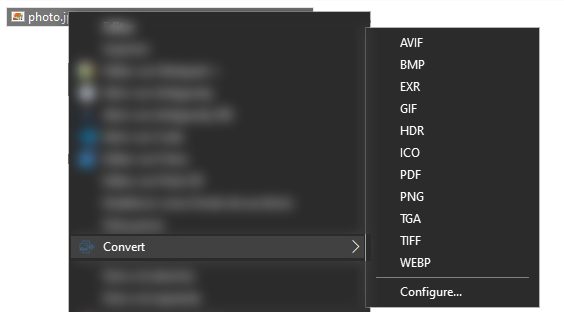

<p align="center">
  <a href="#readme"></a>
</p>

<h1 align="center">img-converter</h1>

<p align="center">
  <strong>Fast, offline image converter for the Windows File Explorer right-click menu, written in Rust.</strong>
</p>

<p align="center">
  <a href="#license"></a>
  <a href="#requirements"></a>
  <a href="https://www.rust-lang.org/"></a>
  <a href="SECURITY.md"></a>
  <a href="#languages"></a>
</p>

---

## Overview

**img-converter** adds a **Convert** submenu to the File Explorer right-click menu. Select one or many images (or PDFs), pick a format, and the converted files are written next to the originals. Everything runs locally: no uploads, no ads, no background services.

<p align="center">
  <a href="#readme"></a>
</p>

## Features

- **Right-click integration**: works with single files and multi-selections; only the formats that make sense for the selection are listed.
- **Many formats**: see the [format table](#supported-formats). Includes HEIC, camera RAW, SVG, DDS, HDR and OpenEXR input.
- **PDF tools**: convert images to PDF (several selected images are merged into one PDF, in natural file-name order) and extract every page of a PDF as images.
- **Safe output**: existing files are never overwritten by default (`photo (1).webp`, `photo (2).webp`, ...); files are written atomically, so a failed conversion never leaves a half-written file.
- **Correct images**: EXIF orientation is applied, transparency is flattened onto a configurable background for formats without alpha, and ICC color profiles and EXIF metadata are kept where the format supports them.
- **Stable Explorer**: the Explorer extension contains no image decoders; conversions run in a separate `img-converter.exe` process, so a broken file cannot crash Explorer.
- **Protected against image bombs**: dimension, memory and file-size limits are checked before pixel buffers are allocated.
- **Clear errors**: if a file cannot be converted, a dialog explains why in plain language, with the technical details on demand, a button to open the log and, when a Windows codec is missing, a button to its free Microsoft Store page.
- **Per-user install**: no administrator rights, clean uninstall from *Settings → Apps*.
- **Languages**: English and Spanish, following the Windows display language (configurable).

## Supported formats

| Format | Extensions | Read | Write | Notes |
| :--- | :--- | :---: | :---: | :--- |
| JPEG | `.jpg`, `.jpeg` | ✅ | ✅ | Configurable quality |
| JFIF | `.jfif` | ✅ | — | Converting to JPG is a lossless copy |
| PNG | `.png` | ✅ | ✅ | Lossless, keeps transparency |
| WebP | `.webp` | ✅ | ✅ | Output is lossless |
| AVIF | `.avif` | ✅¹ | ✅ | Configurable quality and speed |
| GIF | `.gif` | ✅ | ✅ | First frame; 256-color palette |
| ICO | `.ico` | ✅ | ✅ | Single icon or 16–256 px bundle |
| BMP | `.bmp` | ✅ | ✅ | |
| TIFF | `.tif`, `.tiff` | ✅ | ✅ | |
| TGA | `.tga` | ✅ | ✅ | |
| HDR | `.hdr` | ✅ | ✅ | Radiance RGBE, linear light |
| OpenEXR | `.exr` | ✅ | ✅ | 32-bit float, linear light |
| PDF | `.pdf` | ✅ | ✅ | Pages rendered by Windows; images merged into one PDF |
| SVG | `.svg` | ✅ | — | Rasterized with `resvg` at a configurable scale |
| DDS | `.dds` | ✅ | — | First mipmap |
| HEIC / HEIF | `.heic`, `.heif` | ✅² | — | iPhone and modern phone photos |
| Camera RAW | `.cr2`, `.cr3`, `.nef`, `.arw`, `.dng`, `.raw` | ✅³ | — | |

1. Uses the Windows **AV1 Video Extension** (preinstalled on Windows 11, [free in the Microsoft Store](https://apps.microsoft.com/detail/9MVZQVXJBQ9V) for Windows 10). The installer tells you when it is missing.
2. Uses the Windows **HEIF Image Extensions** and **HEVC Video Extensions** from the Microsoft Store.
3. Uses the Windows RAW codec (built into Windows 10 1903+ and Windows 11; install or update the free [Raw Image Extension](https://apps.microsoft.com/detail/9NCTDW2W1BH8) for the latest cameras). If the codec cannot read a file, the full-size preview embedded by the camera is converted instead.

## Requirements

- Windows 10 or Windows 11 (x64, x86 or ARM64).
- Use the installer that matches your Windows architecture: Explorer only loads extensions built for its own architecture.

## Installation

Download the installer from the [Releases](https://github.com/stickylfs/img-converter/releases) page and run it:

| File | System |
| :--- | :--- |
| `img-converter-setup.exe` | Windows 10/11 64-bit (recommended) |
| `img-converter-setup-x86.exe` | Windows 10 32-bit |
| `img-converter-setup-arm64.exe` | Windows 11 on ARM |

Each release includes a `SHA256SUMS.txt` file to verify the download.

Everything is installed for the current user, without administrator rights:

| What | Where |
| :--- | :--- |
| Program | `%LOCALAPPDATA%\Programs\img-converter` |
| Settings and error log | `%LOCALAPPDATA%\img-converter` |
| Start Menu | *img-converter* folder with a shortcut to the settings file |
| Context menu | Registered for the current user (`HKCU`) |

Running the installer again offers **Update** or **Repair** (depending on the installed version) and **Uninstall**.

> [!TIP]
> On Windows 11, the **Convert** entry is in the classic menu: choose **Show more options** or hold **Shift** while right-clicking.

### Unattended installation

```powershell
.\img-converter-setup.exe --silent              # install, update or repair
.\img-converter-setup.exe --uninstall --silent  # uninstall
```

### Uninstall

Use *Settings → Apps → Installed apps → img-converter → Uninstall*, or run the installer again and choose **Uninstall**. All files, registry entries, shortcuts and settings are removed.

## Usage

1. Select one or more files in File Explorer.
2. Right-click and choose **Convert** (Windows 11: **Show more options** first).
3. Pick the target format. The new files appear next to the originals.

### Command line

`img-converter.exe` (in the install folder) can also be used from scripts:

```powershell
img-converter.exe png photo.jpg                  # one file
img-converter.exe webp a.png b.png c.png         # several files
img-converter.exe pdf page1.png page2.png        # merge into page1.pdf
img-converter.exe jpg document.pdf               # extract every page
img-converter.exe png --list files.txt           # UTF-8 list, one path per line (deleted after reading)
```

Add `--notify` to show a dialog when some files fail. Settings are read from `config.ini`. The program has no console window; use `Start-Process -Wait -PassThru` to read the exit code:

| Exit code | Meaning |
| :---: | :--- |
| 0 | All files converted |
| 1 | Invalid arguments |
| 3 | No file could be converted |
| 6 | Some files failed |

## Configuration

Settings live in `%LOCALAPPDATA%\img-converter\config.ini`. Open it from **Convert → Configure...** in the context menu or from the Start Menu shortcut. Changes apply immediately.

| Section | Key | Values | Default | Description |
| :--- | :--- | :--- | :---: | :--- |
| `[menu]` | `enabled_formats` | `all` or a list such as `jpg, png, webp, pdf` | `all` | Formats shown in the submenu |
| `[quality]` | `jpeg` | 1–100 | 100 | JPEG quality |
| | `avif` | 1–100 | 100 | AVIF quality |
| | `avif_speed` | 1–10 | 6 | 1 = slowest / smallest files, 10 = fastest |
| `[svg]` | `scale` | 0.1–10.0 | 2.0 | SVG rasterization scale |
| `[ico]` | `multi_resolution` | `true` / `false` | `false` | Write 16, 32, 48, 64, 128 and 256 px layers |
| `[pdf]` | `dpi` | 72–1200 | 300 | Resolution of extracted PDF pages |
| | `create_subfolder` | `true` / `false` | `true` | Put the pages of multi-page PDFs in a subfolder |
| `[transparency]` | `matte` | `white` / `black` | `white` | Background for formats without transparency |
| `[general]` | `overwrite` | `true` / `false` | `false` | Overwrite existing files instead of numbering them |
| | `preserve_metadata` | `true` / `false` | `true` | Keep ICC profiles and EXIF (JPEG, PNG, WebP; ICC for TIFF) |
| | `language` | `auto` / `en` / `es` | `auto` | Menu language |

Errors are logged to `%LOCALAPPDATA%\img-converter\last_error.log`.

## Building from source

Requirements: [Rust](https://rustup.rs/) 1.82+ and the [Visual Studio Build Tools](https://visualstudio.microsoft.com/visual-cpp-build-tools/) with the *Desktop development with C++* workload.

```bash
git clone https://github.com/stickylfs/img-converter.git
cd img-converter
cargo test --workspace

# The installer embeds the worker and the shell extension, so build them first:
cargo build --release -p img-converter-worker -p img-converter-shell
cargo build --release -p img-converter-installer
```

The installer is written to `target/release/img-converter-setup.exe`. For other architectures add `--target i686-pc-windows-msvc` or `--target aarch64-pc-windows-msvc` to both commands.

## Project structure

```
img-converter/
├── assets/                       # Logo and application icon
├── crates/
│   ├── img-converter-common/     # Formats, conversion matrix, config.ini parser, i18n
│   ├── img-converter-core/       # Decoders, encoders, PDF engine, orientation, atomic writes
│   ├── img-converter-worker/     # img-converter.exe (conversion process and CLI)
│   ├── img-converter-shell/      # img_converter_shell.dll (Explorer context menu, COM)
│   └── img-converter-installer/  # img-converter-setup.exe (per-user installer/uninstaller)
├── docs/architecture.md          # How the pieces fit together
├── .github/workflows/            # CI (lint, test, build) and release pipelines
├── CHANGELOG.md
├── CONTRIBUTING.md
├── SECURITY.md
├── THIRD-PARTY-NOTICES
└── LICENSE
```

## Privacy

img-converter has no network code and sends no telemetry; your images never leave your computer. See [SECURITY.md](SECURITY.md) for the threat model and for how to report vulnerabilities.

## Contributing

Bug reports and pull requests are welcome. See [CONTRIBUTING.md](CONTRIBUTING.md) and [docs/architecture.md](docs/architecture.md).

## Credits

- Developed with [Google Antigravity](https://antigravity.google) and [Claude](https://claude.ai).
- [image](https://github.com/image-rs/image): decoders and encoders for most raster formats.
- [ravif](https://github.com/kornelski/cavif-rs) and [rav1e](https://github.com/xiph/rav1e): AVIF encoding.
- [resvg](https://github.com/linebender/resvg): SVG rendering.
- [kamadak-exif](https://github.com/kamadak/exif-rs), [image_dds](https://github.com/ScanMountGoat/image_dds), [pdf-writer](https://github.com/typst/pdf-writer), [lopdf](https://github.com/J-F-Liu/lopdf).
- [windows-rs](https://github.com/microsoft/windows-rs): Rust bindings for Win32, COM and WinRT.

See [THIRD-PARTY-NOTICES](THIRD-PARTY-NOTICES) for licenses.

## License

Released under the [MIT License](LICENSE).
